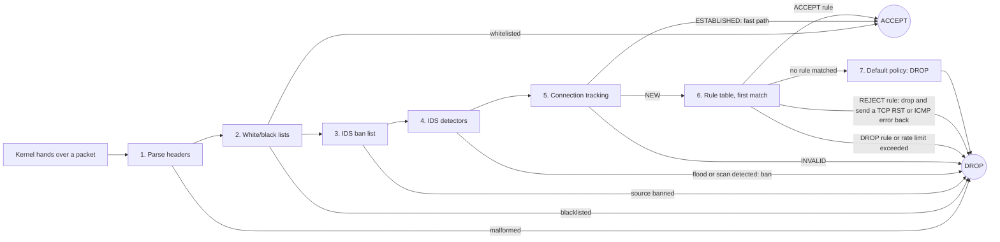
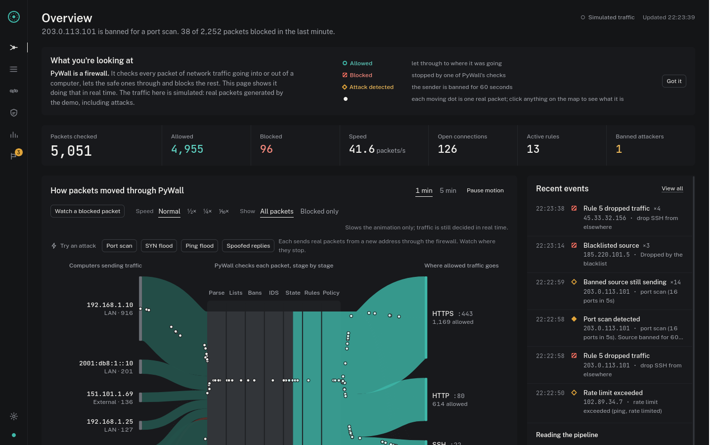
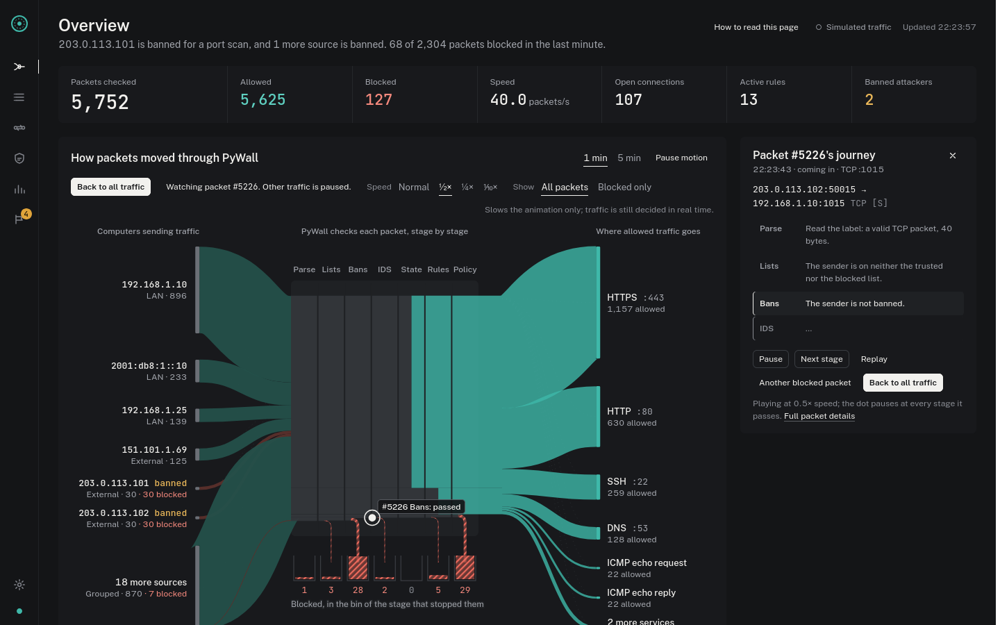
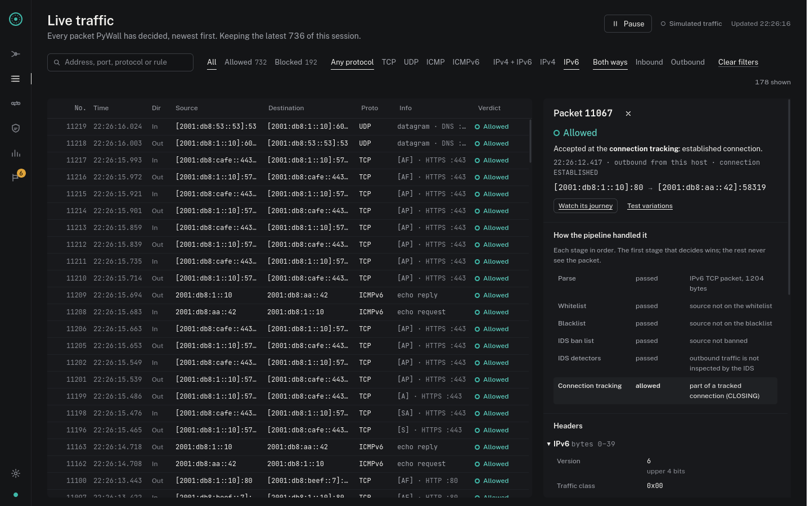
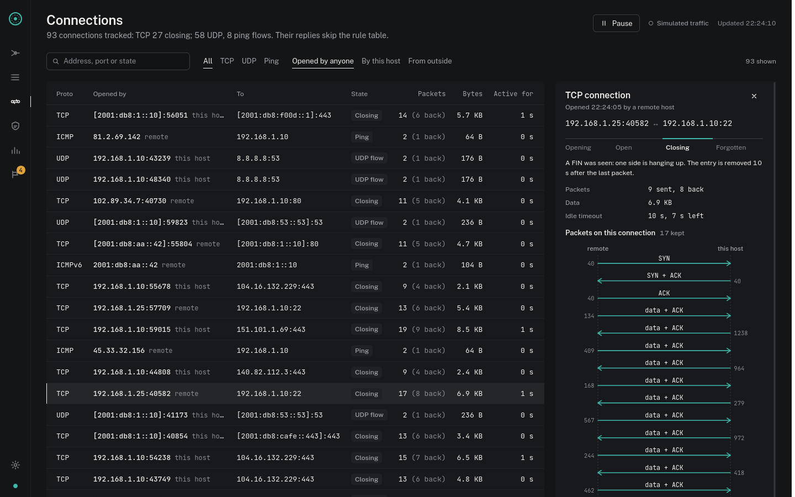
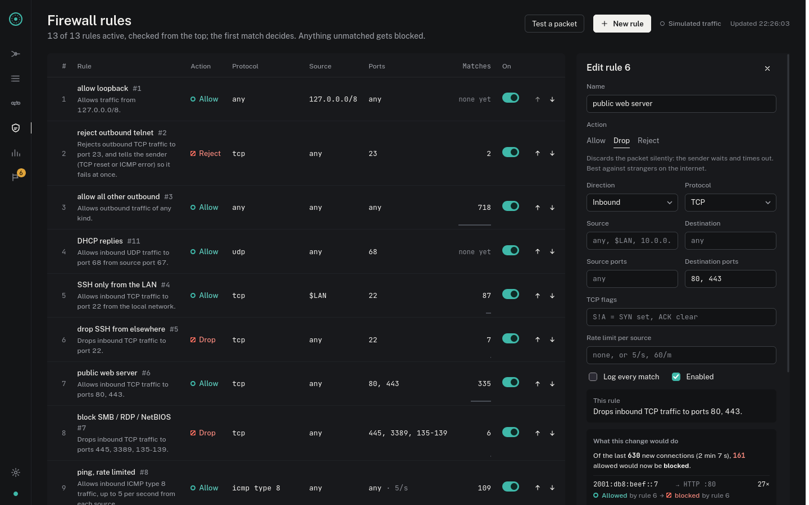
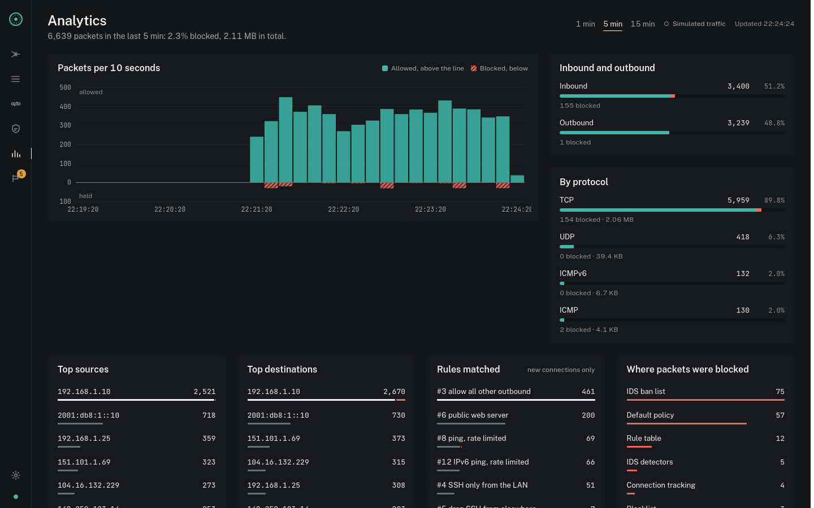
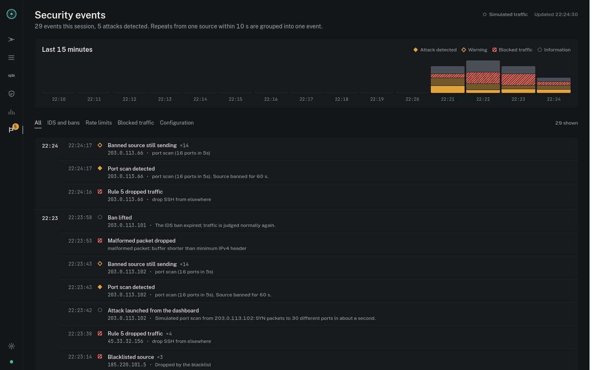

# PyWall

**A stateful packet-filtering firewall for Linux, written in Python, with a real-time web dashboard that shows and explains every decision.**

PyWall receives every IPv4 and IPv6 packet entering or leaving a machine and decides, packet by packet, whether to let it through. It does this through Linux's own netfilter framework, so the decisions are real. It tracks connections, enforces an ordered rule table, rate-limits traffic, and detects and bans port scans, SYN floods and ping floods. The dashboard draws the traffic flowing through the firewall's pipeline. You can click any packet to see exactly which stage and which rule decided it, and why.

**Live demo: [pywall-demo.onrender.com](https://pywall-demo.onrender.com/)** (read-only, simulated traffic) · **Code: [github.com/DE9856/Firewall-Implementation](https://github.com/DE9856/Firewall-Implementation)** · **Project report: [docs/Firewall-Implementation-Report.pdf](docs/Firewall-Implementation-Report.pdf)**

Built by Deepesh Kumar Kotta as a Computer Networks course project ("Firewall implementation: create a firewall to filter packets and enhance network security").

> The demo is on Render's free plan, so it sleeps when nobody is using it. The first visit after a quiet spell takes about a minute to wake it up.


## Contents

- [What a firewall does, in one minute](#what-a-firewall-does-in-one-minute)
- [Features](#features)
- [How PyWall decides](#how-pywall-decides)
- [Quick start (no root needed)](#quick-start-no-root-needed)
- [The dashboard](#the-dashboard)
- [Writing rules](#writing-rules)
- [Live mode: filtering real traffic](#live-mode-filtering-real-traffic)
- [Deploying a public demo](#deploying-a-public-demo)
- [Command reference](#command-reference)
- [Testing](#testing)
- [Project structure](#project-structure)
- [Demo videos](#demo-videos)
- [Developing the dashboard](#developing-the-dashboard)
- [Troubleshooting](#troubleshooting)
- [Limitations](#limitations)

## What a firewall does, in one minute

Data on a network travels in small **packets**. Each packet carries a **header**, a label that says:

- who sent it (source IP address)
- who it is for (destination address)
- which service it is meant for (the **port**: 443 for secure web pages, 22 for SSH remote login, 53 for DNS)
- which **protocol** it uses (TCP, UDP or ICMP)

A firewall is like the security desk of a building. It reads every packet's header, ignoring its contents, and checks it against a list of **rules** from the top. The **first rule that matches** decides: **ACCEPT** (let it through), **DROP** (discard it silently) or **REJECT** (discard it, and tell the sender so it gives up at once). Anything no rule allows is dropped: **default deny**.

A **stateful** firewall also keeps a visitor book of open **connections**. When your laptop opens a web page, the website's replies are recognised as part of that conversation and let in. A stranger who pretends to be continuing a conversation that never started is stopped.

## Features

**Firewall engine**

- Parses IPv4, IPv6 (including extension headers), TCP, UDP, ICMP and ICMPv6 headers directly from raw bytes, with no packet library.
- Ordered rule table matching on:
  - direction (in or out) and protocol
  - source and destination address (CIDR) and port (lists and ranges)
  - ICMP type and TCP flags
  - per-source rate limits
  - a log flag
- Three actions: **ACCEPT**, **DROP** (silently) and **REJECT** (drop, and answer the sender with a TCP reset or an ICMP error so it fails at once instead of timing out).
- Default-deny policy.
- **Rule-table analysis**: flags any rule that can never decide a packet because an earlier rule already matches everything it matches (shadowed or redundant), with a one-click fix.
- **"What if" previews**: before a rule change is saved, recent real traffic is replayed through the new rule order and every verdict that would change is listed.
- **Connection tracking** (NEW / ESTABLISHED / INVALID) with timeouts. Replies to allowed traffic take a fast path that skips the rules; stray and spoofed packets are dropped.
- **Intrusion detection**: SYN-flood, port-scan and ping-flood detectors (IPv4 and IPv6) that ban the offending source for 60 seconds. Thresholds can be tuned and sources banned or released from the dashboard.
- **Token-bucket rate limiting** on any rule (e.g. ping limited to 5 per second per source).
- Blacklist and whitelist of networks.

**Ways to feed it traffic**

- **Live**: real kernel packets through netfilter **NFQUEUE**, with verdicts enforced (root).
- **pcap replay**: any `tcpdump` capture replayed through the engine.
- **Simulated**: real IPv4 and IPv6 packets built in code, with normal sessions plus recurring attacks, and **attack buttons** that launch a port scan, SYN flood, ping flood or spoofed replies on demand. No root needed.

**Dashboard**

- **Overview** flow map of the traffic moving through the pipeline.
- **Live traffic** packet list and inspector, with the pipeline trace, rule conditions, header fields and hex bytes (and the reply a REJECT sent).
- **Connections**: the connection-tracking table live, with each connection's packets drawn as a sequence (ladder) diagram: SYN, SYN-ACK, ACK, data, FIN.
- **Firewall rules**: a plain-language rule table with live editing, impact previews, shadowed-rule warnings and a packet tester.
- **Analytics** and **Security events** timelines.
- **Session history** saved to SQLite, so events, blocked packets and counters survive a restart; a downloadable **session report** (Markdown) and **blocked packets as a pcap** for Wireshark.
- Built for people new to firewalls: a first-visit guide, plain-language labels and hover explanations.
- **Slow motion and packet journeys**:
  - slow the animation down to ⅒ speed
  - show only blocked packets, each tagged with why it is being stopped
  - follow one real blocked packet as it pauses at every stage, while a panel explains what each stage found

**For real networks**

- Auto-detects the network interface and subnet (`-i auto --lan auto`).
- Adopts connections already open at start-up, so starting PyWall doesn't cut your browser or SSH session.
- `doctor` pre-flight check, `--dry-run` rehearsal, and a checker script that verifies live verdicts from the outside.

## How PyWall decides

Every packet takes the same path. The first stage that can decide returns the verdict, and the stages after it never see the packet.



| Stage | What it checks |
| --- | --- |
| Parse | Is this a valid IPv4 or IPv6 packet with a readable TCP/UDP/ICMP header? |
| Lists | Is the source on the whitelist (always allowed) or the blacklist (always dropped)? |
| IDS ban list | Did the intrusion detector ban this source recently? |
| IDS detectors | Per source, inbound only: more than 20 SYNs in 1 s (SYN flood), more than 15 distinct ports in 5 s (port scan), or more than 10 pings in 1 s (ping flood). Crossing a limit bans the source for 60 s. |
| Connection tracking | Does the packet belong to a known connection? A TCP packet without SYN, or an echo reply, cannot start one, so with no connection it is INVALID. |
| Rule table | The first rule whose conditions all match decides. Rate-limited rules drop packets over the limit. A REJECT rule drops the packet and answers the sender: a TCP reset for TCP, ICMP "port unreachable" for UDP, "administratively prohibited" for a ping. Error packets are never answered, so two firewalls can't bounce replies off each other. |
| Default policy | Whatever no rule matched (DROP in the shipped configuration). |

**Example.** Someone on the internet tries to SSH into your laptop (TCP port 22). The packet is valid, not listed, not banned and below the detector limits. It is NEW. In the rule table, "SSH only from the LAN" doesn't match because the source is outside your network, and "drop SSH from elsewhere" does. Verdict: DROP. The dashboard's packet inspector shows exactly this trace for any packet.

## Quick start (no root needed)

Requirements: Linux (or macOS for everything except live mode) and **Python 3.10+**. Nothing to install for the steps below.

```bash
git clone <your-repo-url> pywall && cd pywall

python3 pywall.py check                     # validate and list the rule set
python3 pywall.py simulate                  # 13 attack and traffic scenarios, 80 packets
python3 -m unittest discover -s tests -t .  # 65 unit tests
python3 pywall.py serve                     # dashboard with simulated traffic
```

Open **http://127.0.0.1:8080**. The badge in the top-right corner always says which traffic source is running.

A short tour for a presentation:

1. **Overview**: press **Try an attack › Port scan**. Within a second the attacker gets its own red stream, the IDS bans it, and its packets pile up in the Bans bin. Click its address to follow it.
2. **Watch a blocked packet** to follow one packet stage by stage at slow speed.
3. **Live traffic**: open any packet to see its pipeline trace, header fields and bytes. Filter to IPv6, or find a rejected Telnet attempt and the TCP reset PyWall sent back.
4. **Connections**: open a TCP connection to see its handshake as a ladder diagram.
5. **Firewall rules**: edit "public web server" and switch it to Drop. **What this change would do** lists the visitors who would have been blocked. Cancel to leave it unchanged.

Session history is saved in `data/history.sqlite`, so restarting the server keeps earlier events and blocked packets. Add `--no-history` to keep a session in memory only.

## The dashboard

| Section | What you can do |
| --- | --- |
| **Overview** | On simulated traffic, **Try an attack** sends a port scan, SYN flood, ping flood or spoofed replies from a fresh address; the attacker gets its own stream on the map and a status line follows it until the IDS bans it. Watch the flow map: computers sending traffic on the left; PyWall's pipeline in the middle, one column per stage; destinations (services) on the right. Blocked traffic turns down into the **bin of the stage that stopped it**, and each moving dot is one real packet. Click a source, stream, stage or bin to filter the map to that traffic; the right-hand panel explains it and links to its packets. Use **Speed** (Normal to ⅒×) and **Show: Blocked only** to slow things down, or **Watch a blocked packet** to follow a single packet stage by stage (**Back to all traffic** or Esc returns). |
| **Live traffic** | A Wireshark-style list of every decided packet, with search, filters (verdict, protocol, IP version, direction) and pause. Click a packet to open the **inspector**: the verdict, each pipeline stage it passed, why the matching rule matched (condition by condition), every header field with a plain-language note, and the raw bytes, highlighted as you hover a field. |
| **Connections** | Every connection PyWall is tracking: who opened it, its state (opening, open, closing, UDP flow, ping), packets each way, and how long until it is forgotten. Click one for a ladder diagram of its packets and an explanation of its state. |
| **Firewall rules** | The rule table in evaluation order, each rule as a plain-English sentence, with hit counts. Rules that can never decide anything are marked, with a button to move them where they would work. Enable or disable, reorder, create, edit and delete rules: while you edit, **What this change would do** replays recent traffic and lists the verdicts that would change. Changes are validated, applied immediately and saved to `config/rules.json`. On the read-only demo the editor still works as a preview, without saving. **Test a packet** shows which rule a made-up packet would hit and why every other rule did not match. |
| **Analytics** | Allowed vs dropped over time, inbound vs outbound, protocols, top sources and destinations, rules matched, and where packets were dropped, over 1, 5 or 15 minutes. |
| **Security events** | A timeline of IDS detections, bans, rate limits, dropped traffic and rule changes, each linked to the packets behind it. |
| **Settings** | Connection status and the running configuration; edit IDS thresholds and ban length; ban or release an address by hand; see saved sessions; download the session report and the blocked-packet capture. |

**Colour codes:** teal means allowed, coral with a diagonal hatch means blocked, and amber means an IDS detection or rate limit. Every colour also has a shape, so the screen works for colour-blind viewers. Motion follows your system's reduced-motion setting.

| First visit: what you're looking at | Following one blocked packet |
| --- | --- |
|  |  |
| **Live traffic: an IPv6 packet in the inspector** | **Connections: a TCP session as a ladder diagram** |
|  |  |
| **Rules: what switching the web server to Drop would do** | **Analytics** |
|  |  |
| **Security events** | |
|  | |

Other traffic sources for the dashboard:

```bash
python3 pywall.py serve --source pcap --pcap demo/sample.pcap --loop   # replay a capture
sudo .venv/bin/python pywall.py serve --source live -i auto --lan auto   # real packets (see Live mode)
```

## Writing rules

Rules live in `config/rules.json` and are checked top to bottom; the first match wins.

```json
{
  "default_policy": "DROP",
  "stateful": true,
  "drop_invalid": true,
  "pickup_outbound": true,
  "local_networks": ["192.168.1.0/24", "2001:db8:1::/64"],
  "whitelist": [],
  "blacklist": ["185.220.101.0/24"],
  "ids": {
    "enabled": true, "block_seconds": 60,
    "syn_flood":  {"threshold": 20, "window": 1},
    "port_scan":  {"threshold": 15, "window": 5},
    "icmp_flood": {"threshold": 10, "window": 1}
  },
  "rules": [
    {"id": 4, "name": "SSH only from the LAN", "action": "ACCEPT", "direction": "in",
     "protocol": "tcp", "dst_port": 22, "src": "$LAN", "log": true},
    {"id": 8, "name": "ping, rate limited", "action": "ACCEPT", "direction": "in",
     "protocol": "icmp", "icmp_type": 8, "rate_limit": "5/s"},
    {"id": 2, "name": "reject outbound telnet", "action": "REJECT", "direction": "out",
     "protocol": "tcp", "dst_port": 23, "log": true}
  ]
}
```

| Rule field | Values | Meaning |
| --- | --- | --- |
| `action` | `ACCEPT`, `DROP`, `REJECT` | What to do when the rule matches (required). `REJECT` drops and tells the sender: good for outbound traffic from your own programs; `DROP` is better against strangers, who learn nothing. |
| `direction` | `in`, `out`, `any` | Inbound to this host, outbound from it, or both. |
| `protocol` | `tcp`, `udp`, `icmp`, `icmpv6`, `any` | The IP protocol. |
| `src`, `dst` | `"10.0.0.0/8"`, `"2001:db8::/32"`, a list, `"$LAN"` | Source and destination networks in CIDR form, IPv4 or IPv6. `$LAN` means `local_networks`. |
| `src_port`, `dst_port` | `22`, `"8000-8100"`, `[80, 443]` | Ports and ranges (TCP and UDP only). |
| `icmp_type` | e.g. `8` | ICMP: 8 echo request (ping), 0 echo reply, 3 unreachable, 11 time exceeded. ICMPv6: 128 echo request, 129 echo reply, 133-136 neighbour discovery. |
| `tcp_flags` | e.g. `"S!A"` | Letters before `!` must be set and letters after it must be clear (S, A, F, R, P, U). |
| `rate_limit` | `"5/s"`, `"60/m"` | Allow at most this rate per source; extra packets are dropped. |
| `log` | `true` | Record every match as a security event. |
| `enabled` | `false` | Keep the rule but skip it. |

Rules are validated when they load. A typo such as port `99999` stops PyWall with a message that names the rule. The dashboard also analyses the order: a rule placed below a broader one that already matches all its packets can never decide anything, and it is flagged as **shadowed** (the earlier rule does something else) or **redundant** (it does the same). The shipped rule set allows outbound traffic, the web server (80/443), SSH from the LAN, rate-limited ping (IPv4 and IPv6), ICMPv6 neighbour discovery and DHCP replies; it rejects outbound Telnet and drops SMB, RDP and NetBIOS.

## Live mode: filtering real traffic

Live mode makes PyWall enforce its verdicts on the machine it runs on. It needs:

- **Linux**: netfilter is part of the Linux kernel.
- **Root (sudo)**: hooking into the kernel's packet path needs administrator rights.
- **The NetfilterQueue Python package**, installed once:

```bash
sudo dnf install -y libnetfilter_queue-devel gcc python3-devel     # Fedora
# sudo apt install -y libnetfilter-queue-dev build-essential python3-dev   # Debian/Ubuntu
python3 -m venv .venv && .venv/bin/pip install -r requirements.txt
```

Use `sudo .venv/bin/python …` (the virtual environment's Python) for every live command.

**How it hooks in.** PyWall inserts two iptables rules: INPUT traffic goes to NFQUEUE 1 and OUTPUT traffic to NFQUEUE 2. The kernel holds each packet until PyWall returns a verdict. Both rules carry `--queue-bypass`, so traffic flows normally if PyWall is not running, and Ctrl+C removes both rules. With `--ipv6` the same two rules also go into ip6tables.

**REJECT replies** are written to a raw socket. They carry the firewall mark `0x5057`, and the OUTPUT hook skips marked packets (`-m mark ! --mark 0x5057`), so PyWall never judges its own replies. A `--dry-run` drops nothing, so it sends no replies either.

**IPv6 needs neighbour discovery** (ICMPv6 types 133-136) to work at all. The shipped rule set allows inbound ICMPv6 (rule 13), so enabling `--ipv6` doesn't cut the machine off its IPv6 network.

### Option A: a private test network (safest)

```bash
sudo .venv/bin/python demo/live_demo.py
```

This builds a virtual "attacker" network namespace connected to your machine by a veth cable. It then filters **only that interface** and runs real attacks against it:

- a web request
- blocked SSH and RDP
- outbound Telnet
- a spoofed ACK
- a ping burst
- a port scan
- a SYN flood

Afterwards it removes everything. Your real network is never touched. `python3 demo/record_demo.py --live demo/live_session.json` turns the recorded session into a video.

### Option B: the real network (for a demonstration)

1. **Pre-flight check**. It changes nothing:
   ```bash
   sudo .venv/bin/python pywall.py doctor
   ```
2. **Rehearse with a dry run**. Every verdict is shown and nothing is dropped:
   ```bash
   sudo .venv/bin/python pywall.py serve --source live -i auto --lan auto --dry-run
   ```
3. **Verify from the outside**, in a second terminal without sudo:
   ```bash
   python3 demo/check_live.py
   ```
   It sends HTTPS, DNS, ping and Telnet traffic and confirms each verdict through the dashboard's API. Telnet is held by a REJECT rule, so when enforcing, the client must be refused at once rather than time out.
4. **Enforce**: Ctrl+C, then the same command without `--dry-run`. Run `check_live.py` again: Telnet must now be refused while browsing keeps working.
5. **Stop** with Ctrl+C. Then `sudo iptables -S | grep NFQUEUE` (and `sudo ip6tables -S | grep NFQUEUE` after `--ipv6`) should print nothing.

What makes this safe on a real network:

- **`-i auto`** filters only the interface that carries your default route (Wi-Fi or Ethernet). The dashboard runs on `127.0.0.1`, and loopback is never filtered.
- **`--lan auto`** detects your subnet, so rules written with `$LAN` follow whichever network you are on.
- **Connection pickup**: connections open before PyWall started (browser tabs, SSH) are adopted when your machine sends on them, like the Linux kernel's own loose TCP pickup. Unsolicited inbound packets are still dropped. To turn it off, set `"pickup_outbound": false`.
- Only the first 128 bytes of each packet are copied to Python, and the queues hold 8,192 packets. Still, every packet goes through Python, so avoid heavy streaming during a demo.

To show attacks in a demo, have a classmate (with their agreement) do these from another device on the same network:

- send fast pings to your laptop: the rate limit holds back the extras
- run `nmap <your-ip>`: port-scan detection bans them for 60 seconds
- SSH to your laptop: allowed from the LAN

## Deploying a public demo

Live filtering cannot run on hosting platforms such as Render, Vercel or Heroku: it needs root and the kernel's netfilter on the machine being protected. What you **can** deploy is the dashboard with simulated traffic, in **read-only** mode. Rule and IDS changes are refused. Visitors can still try rule changes and see their effect (nothing is saved), test packets, and launch attacks with the attack buttons (one every 2 seconds; attacks change no configuration).

`render.yaml` describes it as one free Render web service, with nothing to install:

1. Push this repository to GitHub.
2. On [Render](https://render.com): **New > Blueprint**, then pick the repository. Render creates the `pywall-demo` service from `render.yaml`.
3. Open the `onrender.com` URL. This project's demo runs at **https://pywall-demo.onrender.com/**.

The same thing locally:

```bash
PORT=10000 python3 pywall.py serve --host 0.0.0.0 --read-only
```

On Render's free plan the service sleeps after about 15 idle minutes and wakes in about a minute, so open the link shortly before presenting. Render's free disk is temporary, so the saved history and the statistics restart with each wake-up.

## Command reference

`python3 pywall.py [-c CONFIG] [-v] [--log FILE] <command> [options]`

| Command | What it does |
| --- | --- |
| `check` | Validate `config/rules.json` and print the rule table. |
| `simulate` | Run the 13 scripted scenarios (80 packets, including IPv6 and REJECT) and print pass/fail per packet plus statistics. |
| `pcap FILE` | Replay a capture through the engine and print statistics. |
| `live` | Filter this machine's real traffic in the terminal (root). |
| `serve` | Run the web dashboard with a traffic source. |
| `doctor` | Check that this machine is ready for a live demonstration. |

Global options:

| Option | Meaning |
| --- | --- |
| `-c FILE` | Use a different rule set. |
| `-v` | Log every packet, not only drops. |
| `--log FILE` | Also write the log to a file. |

Options for `serve` (most also apply to `live`):

| Option | Meaning |
| --- | --- |
| `--source simulated\|pcap\|live` | Traffic source (default `simulated`). |
| `--pcap FILE` | Capture to replay with `--source pcap`. |
| `--loop` | Replay the capture forever. |
| `--speed N` | Speed multiplier for simulated or replayed traffic. |
| `--seed N` | Random seed for repeatable simulated traffic. |
| `-i IFACE` / `-i auto` | Live mode: filter only this interface, or the default route's. |
| `--lan CIDR[,CIDR]` / `--lan auto` | Set the local networks; `$LAN` in rules follows them. |
| `--dry-run` | Live mode: show verdicts but drop nothing. |
| `--host ADDR` | Address to listen on (default `127.0.0.1`; use `0.0.0.0` for a public demo). |
| `--port N` | Port (default: `$PORT` if set, else 8080). |
| `--read-only` | Refuse rule and IDS changes (for a public demo). Previews, the packet tester and attack buttons still work. |
| `--ipv6` | Live mode: also hook ip6tables, so IPv6 is filtered too (`--lan auto` then also detects IPv6 prefixes). |
| `--history FILE` | Save the session history here (default `data/history.sqlite`). |
| `--no-history` | Keep the session in memory only. |

PyWall's output is coloured in a terminal and plain when piped. `NO_COLOR=1` and `FORCE_COLOR=1` override this.

**Dashboard API** (used by the web page; also handy for scripts):

| Endpoint | Purpose |
| --- | --- |
| `GET /api/state` | Full snapshot: stats, rules, config, recent and dropped packets, events, series, flows. |
| `GET /api/stream` | Server-Sent Events: batched updates every 250 ms. |
| `GET /api/flows?window=S` | Flow totals and per-second series for the last S seconds (10 to 900). |
| `GET /api/packets/ID` | One packet with its header dissection and pipeline explanation. |
| `POST /api/explain` | What PyWall would do with a described packet (read-only). |
| `GET/POST /api/rules`, `PUT/DELETE /api/rules/ID`, `POST /api/rules/order` | Read and edit the rule table. Each rule carries its analysis finding, if any. |
| `POST /api/rules/preview` | What a create, update, delete or reorder would change, replayed on recent traffic (read-only). |
| `GET /api/connections?limit=N` | The connection-tracking table. |
| `PUT /api/ids`, `POST /api/bans`, `DELETE /api/bans/IP` | Tune intrusion detection; ban or release an address. |
| `POST /api/attack` | Simulated source only: launch `port_scan`, `syn_flood`, `ping_flood` or `spoofed` now (one every 2 s). |
| `GET /api/sessions`, `GET /api/export/report.md`, `GET /api/export/blocked.pcap` | Saved sessions and downloads. |
| `GET /api/health` | Liveness check. |

Requests that change something must send the header `X-PyWall: 1` and a JSON body. A web page from another site cannot do that without a permission the server never grants.

## Testing

| What | How | Result |
| --- | --- | --- |
| Unit tests | `python3 -m unittest discover -s tests -t .` | 65 tests: parsing (IPv4 and IPv6), rules, REJECT replies, conntrack, IDS and its controls, rate limits, pickup, `$LAN`, rule analysis and previews, explanations, monitor, history, exports, HTTP API, read-only mode |
| Scenario simulation | `python3 pywall.py simulate` | 80 of 80 packets get the expected verdict, including IPv6 and REJECT |
| Dashboard, end to end | `python3 pywall.py serve`, in a browser | Every page exercised: attacks launched, detected, banned and pinned on the map; rule previews, shadowed-rule fix, connections ladder, IDS settings, bans, history across a restart, exports |
| Private live network | `sudo .venv/bin/python demo/live_demo.py` | Real port scan and SYN flood detected and banned; 120 accepted, 122 dropped (recorded before REJECT and IPv6 were added) |
| Real network | `serve --source live` + `demo/check_live.py` | HTTPS, DNS, ping work; Telnet really blocked (confirmed against a server that answers on every port; recorded before rule 2 became REJECT) |

**Not yet verified on a real network:** REJECT replies on the wire (raw socket and firewall mark) and IPv6 filtering through ip6tables. Both are covered by unit tests and the simulation, but not by a live run. Before relying on them, run `doctor`, a `--dry-run`, then `demo/check_live.py` while enforcing.

## Project structure

```
pywall.py               command-line interface
config/rules.json       the rule set
firewall/
  packet.py             IPv4/IPv6/TCP/UDP/ICMP parsing, packet building, REJECT replies, header dissection
  rules.py              rule model, matching, $LAN, validation, token bucket
  conntrack.py          connection tracking (NEW / ESTABLISHED / INVALID, pickup)
  ids.py                SYN flood / port scan / ICMP flood detection and bans
  engine.py             the decision pipeline; records stage, direction, header bytes
  explain.py            read-only, stage-by-stage explanation of a verdict
  analysis.py           shadowed/redundant rule detection and "what if" previews
  live.py               iptables NFQUEUE hooks and kernel verdicts
  netinfo.py            default interface and subnet detection
  monitor.py            dashboard data: packets, events, per-second series, flows, connections
  history.py            session history in SQLite
  export.py             session report (Markdown) and blocked packets (pcap)
  server.py             HTTP API, Server-Sent Events, rule editing, static files
  traffic.py            simulated traffic source
  pcap.py               pcap reader
  simulator.py          scripted test scenarios
  colors.py             terminal colours
  web/                  the built dashboard (generated by `npm run build`, committed)
web/                    dashboard source: React + TypeScript + Vite
tests/                  unit tests
demo/                   private test network, probes, live checker, recorder, videos
docs/                   project report (PDF) and the screenshots used in this README
render.yaml             Render blueprint for the public demo
DESIGN.md, PRODUCT.md   the dashboard's design system and product notes
```

## Demo videos

- `demo/pywall_demo.mp4` (101 s): rule validation, a broken rule file being rejected, the attack simulation, a pcap replay and the unit tests.
- `demo/pywall_live_demo.mp4` (about 3 min): the live run on the private test network.

Both were recorded before REJECT, IPv6 and the newer dashboard features (attack buttons, connections, rule previews) were added. Both are drawn as a Fedora terminal (the Ptyxis terminal with its GNOME palette). Every command shown was really executed and its output is real; the replay is slowed down so it can be read. To re-record: `python3 demo/record_demo.py` (needs Pillow and ffmpeg) and `python3 demo/record_demo.py --live demo/live_session.json`.

## Developing the dashboard

The dashboard source is in `web/` (React 18, TypeScript, Vite, a little d3 for scales and curves). Fonts are bundled, so it works offline.

```bash
python3 pywall.py serve        # the backend, on :8080
cd web && npm install
npm run dev                    # Vite dev server; /api is proxied to :8080
npm run build                  # type-check and build into firewall/web/
```

Commit the rebuilt `firewall/web/` with your changes, because that is what the Python server and Render serve.

## Troubleshooting

| Problem | Fix |
| --- | --- |
| `netfilterqueue is not installed` | Run live commands with `sudo .venv/bin/python`, not `sudo python3`. sudo uses the system Python, which does not have the package. |
| NetfilterQueue fails to build | Install the kernel queue headers first (`libnetfilter_queue-devel` on Fedora, `libnetfilter-queue-dev` on Debian/Ubuntu). |
| `Address already in use` | Another program uses port 8080: add `--port 8081`. |
| Network stopped working after a crash | Remove leftover hooks: `sudo iptables -S \| grep NFQUEUE` (and `ip6tables` if you used `--ipv6`), then delete each listed rule with `sudo iptables -D` followed by the same rule text (for example `sudo iptables -D INPUT -i wlo1 -j NFQUEUE --queue-num 1 --queue-bypass`). |
| `check_live.py` says Telnet was not refused | With the shipped REJECT rule the client should see "connection refused" within a second. If it timed out instead, the reset never arrived: check `sudo iptables -S OUTPUT` shows the `! --mark 0x5057` match, and that PyWall was not started with `--dry-run`. |
| History warning at start-up | `data/history.sqlite` couldn't be opened (for example it belongs to root after an old live run). Fix the owner, pass `--history` with another path, or use `--no-history`. |
| Dashboard says "Disconnected" | The server stopped. Restart `pywall.py serve`; the page reconnects by itself. |
| firewalld is active | Fine. firewalld filters after PyWall; `doctor` reports it. |
| Rule or IDS changes refused | The server was started with `--read-only` (public demo mode). |
| Attack buttons missing | They only appear with simulated traffic, not for a pcap replay or live packets. |

## Limitations

- IPv6 is filtered in live mode only with `--ipv6`. IPv6 fragments after the first carry no ports, so port rules cannot match them.
- Headers only: no inspection of packet contents (application-layer attacks need an IDS or a web application firewall).
- Every packet passes through Python, which suits a single host and demonstrations, not a busy gateway.
- The IDS uses fixed thresholds, which slow or distributed scans can stay under.
- History keeps 7 days of events and blocked packets; the dashboard shows the last 15 minutes of counters. Allowed packets are not saved.
- The dashboard has no login. It binds to `127.0.0.1`; the public demo is read-only.
